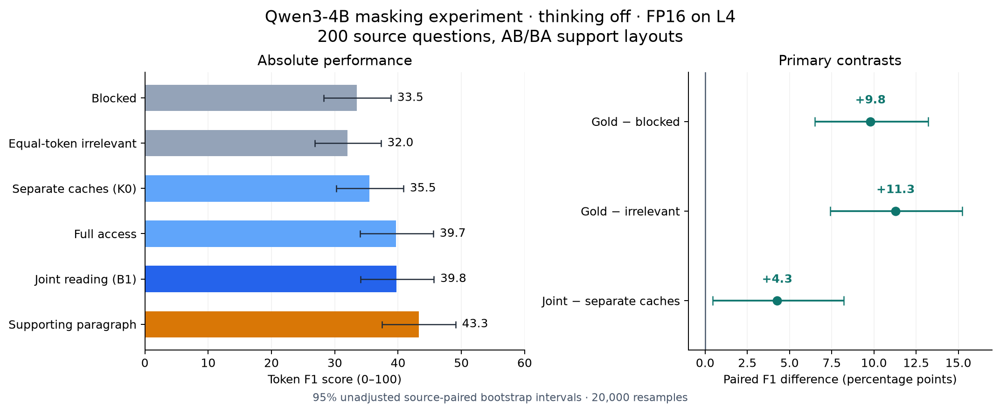

# Completed Qwen3-4B masking experiment on L4

The run completed successfully at **2026-11-18 06:27:14 UTC / 1:27 a.m. EST**,
about 2 hours 48 minutes after the observed wrapper start. All **3,124 generated
responses** are present: 2,400 main MuSiQue answers, 600 shortcut probes,
96 validation answers, and 28 smoke answers. The archive also contains all
48 shared-prefix numerical comparisons and 160 numeric files. The L4 is stopped.

The strongest result is that exposing the supporting paragraph improves the
**fixed-annotation scores**, including against an equal-token irrelevant-access
control. The joint-reading advantage over original separate caches is smaller
and sensitive to order and scoring. Qualitative inspection also found ambiguous
questions, so these scores are not a human-adjudicated semantic-accuracy table.



**Scores.** There are 200 source questions, each in AB and BA layouts, with all
six conditions present on every layout. AB/BA swap which worker carries each supporting hop; encoding remains A then B.
Both layouts are averaged within source;
source questions are the statistical unit. F1 is the protocol's primary metric;
exact match (EM) is secondary. Scores below are on a 0–100 scale.

| Condition | Token F1 | Exact match | Layouts |
|---|---:|---:|---:|
| Joint reading (B1) | 39.76 | 31.75 | 400 |
| Original separate caches (K0) | 35.50 | 29.00 | 400 |
| Blocked cross-worker encoding | 33.49 | 26.75 | 400 |
| Supporting-paragraph access (gold) | 43.28 | 34.75 | 400 |
| Full cross-worker access | 39.67 | 31.75 | 400 |
| Equal-token irrelevant access | 32.00 | 25.25 | 400 |

B1 reads jointly. Original K0 encodes locally, then shifts/stitches keys. The
mask conditions change worker B's access to worker A while encoding; the final
answer stage can read the resulting complete cache. Gold uses oracle support
annotations. The irrelevant control matches the number of visible keys, using
earlier non-support tokens; it does not match their positions. Blocked uses
true-position masked computation, so it is not identical to original K0.

**Primary paired comparisons.** These reproduce the saved protocol summary
from raw rows, using 20,000 bootstrap resamples and seed 20261116. Intervals are
95% unadjusted percentile intervals, not a family-wise significance guarantee.

| F1 difference | Points | 95% interval |
|---|---:|---:|
| Gold − blocked | +9.79 | +6.51 to +13.21 |
| Gold − equal-token irrelevant | +11.28 | +7.40 to +15.22 |
| Joint B1 − original K0 | +4.26 | +0.46 to +8.21 |

Support access helps more than simply exposing an equal number of other keys.
This rules out visible-key count alone as the explanation; support content and
positions still differ. It does not establish the internal mechanism or provide
a deployable method for identifying the gold paragraph.

Full access recovers +6.18 F1 points over blocked (interval +2.58 to +9.89).
Gold exceeds full by +3.61 points (+0.57 to +6.75), a secondary comparison.
This supports selective access on this benchmark, but does not demonstrate
that particular distractor paragraphs actively caused wrong answers.

**How strong is the separate-cache deficit?** The aggregate F1 advantage of B1
is modest. EM is only +2.75 points, with interval −1.00 to +6.50. The descriptive
F1 gap is +0.33 in AB (−5.34 to +6.05) and +8.20 in BA (+3.18 to +13.33).
An additional exploratory paired order interaction is +7.87 points, interval
+0.36 to +15.45, without multiplicity adjustment. A broad order-independent
claim is not supported by this run.

The prespecified shortcut sensitivity leaves 127 sources: all three model-specific
AB probes have F1 below 0.5 and none is truncated. In that subset, gold−blocked
is +10.11 F1 points (+5.91 to +14.53), and gold−irrelevant is +12.25 (+7.59 to
+17.21). B1−K0 is +3.70 (−1.04 to +8.62). The mask-access result survives this
screen more clearly than the generic separate-cache gap. This subset is a
model-dependent sensitivity analysis; the primary cohort remains all 200 sources.

**Output and numerical checks.** Eight of 2,400 main answers hit the answer cap,
all also missing boxes, across four source questions. There are seven capped
probe answers; those cannot qualify for the strict subset. Validation/smoke
answers have no caps or missing boxes. Every saved answer remains in the primary
analysis. Descriptively excluding any source with a capped main answer leaves
gold−blocked +9.48, gold−irrelevant +11.25, and B1−K0 +4.82 F1 points; this
post hoc subset is not a causal cap-effect estimate.

All first-token argmaxes match in the 24 full-mask/B1 validation pairs and the
24 blocked/true-position separate-cache pairs. Full generated token sequences
match in 23/24 pairs for each comparison. At shared teacher-forced prefixes,
argmax differs at 1/903 positions for full/B1 and 2/1040 for blocked/true-position.
Maximum first-logit relative L2 differences are about 0.94% and 0.77%, respectively.
These controls are close, but are not bitwise identical or an equivalence proof.
On the main cohort B1−full is +0.09 F1 points (−1.03 to +1.25), with equal EM means.

The separate decoder-only-prefill engineering check is a different comparison:
it matched the original causal LM's hidden states and every KV tensor bit-for-bit
on short, 1,152-token, and cached 1,152-token inputs on the L4. The longest
4,646-token joint prefill fit at 8,740 MiB peak allocated memory. No chunking or
quantization was used. The failed T4/chunking trials remain separately archived;
their rows were not mixed into this run.

**Question quality still needs attention.** The automatic preparation excluded
historical sources and passed literal-grounding/tokenizer checks. This audit found
no exact-normalized duplicate support paragraphs across the 200 selected sources.
However, no prospective human review records were supplied. Reading illustrative
wins exposed at least two potentially ambiguous annotations:

- `2hop__176712_8311`: the question asks when Katherine of England's father was
  crowned; the supporting paragraph explicitly gives Henry III coronations in
  both 1216 and 1220. Gold access answers the accepted 1216, while blocked/full/
  irrelevant examples answer 1220, which also occurs in the context.
- `2hop__124412_402641`: the question asks for the child of Chiang Hsiao-wen's
  father. The context lists several children. Gold answers accepted Hsiao-wu;
  the irrelevant-access example answers Hsiao-chang, also explicitly a child.

These examples are flags for adjudication, not a complete independent review.
No accepted answers were changed and no ambiguous rows were removed after seeing
outputs. F1 reduces some answer-form brittleness, but neither F1 nor literal
answer presence resolves ambiguous questions. State the headline as an effect
on the fixed benchmark scores until a blinded semantic review is completed.
Illustrative texts and supporting paragraphs are in illustrative-answers.json.

**Scope and provenance.** Qwen/Qwen3-4B, revision
`1cfa9a7208912126459214e8b04321603b3df60c`, FP16, greedy decoding, thinking off,
one seed, NVIDIA L4 in us-central1-b. Main answer cap 1,024; probe/validation
caps 256; context maximum 8,192. Runtime code commit a432bfd; archived code hashes,
question hashes, row fingerprints, options, model revision and actual L4 runtime
metadata all verify. The 102 preflight tests passed before inference. This is
not an 8B replication, thinking experiment, text-report experiment, or direct
comparison with the earlier 25/50-per-cell pilot, which used a different cohort.

The launcher argument `t4` and archive suffix retain their legacy logical
4B-FP16 profile meaning; the physical GPU is explicitly L4. The exact shared
prepared.json hash remains
`8abf29425611b1f3b65f5016fd40651ef0281bdb6de9852e1df2940f33953058`.
The A100 jobs must reuse that bundle. The input bundle/review packet also remains
in ../wmac-t4-v3/shared-prepared.tar.gz.

**Artifacts and reproduction.** The original result archive is preserved byte
for byte, split into seven parts of at most 40 MiB to satisfy GitHub's file-size limit.
No numerical arrays were omitted. Its SHA256 is
`244f3e1e97d5f71027f9319290c9214033311f9fd3ae7d28df96b0d9aa509f85`.

```bash
cd reports/wmac-l4-v3
sha256sum -c SHA256SUMS
cat raw-results.part-* > raw-results.tar.gz
# From the repository root, with NumPy installed:
python reports/wmac-l4-v3/analyze.py
python reports/wmac-l4-v3/supplement.py reports/wmac-l4-v3/raw-results.tar.gz
python reports/wmac-l4-v3/plot.py
```

analyze.py can also reconstruct the parts in a temporary directory automatically,
or accept --archive PATH. It verifies every archived numeric file and sampled
shared-prefix statistics, complete unique ID/condition sets, frozen question/code
hashes, matched-token controls, and re-scores/reproduces the saved means and CIs.
The statistical definition and unchanged scorer live in the pinned repository
code; all recomputed tables/answers are in recomputed/. audit.json records the
checks; supplemental.json records descriptive transitions and cap/order analyses.
runtime-code.tar.gz, run.log.gz, wmac-l4.status, the executed wrapper and package
freeze preserve execution evidence. archive-provenance.json records full and
per-part checksums; SHA256SUMS covers report files.

The local publisher did not collect the bundle before shutdown; later logs show
SSH attempts against the stopped VM. Recovery
used a snapshot of the already stopped disk and a disposable copy mounted read-only
with journal replay disabled on a CPU-only helper. Both downloaded archive checksums
matched the recovery host. The original L4 VM/disk were unchanged. The helper,
copy disk and snapshot were deleted, and the stale local watcher was stopped.
